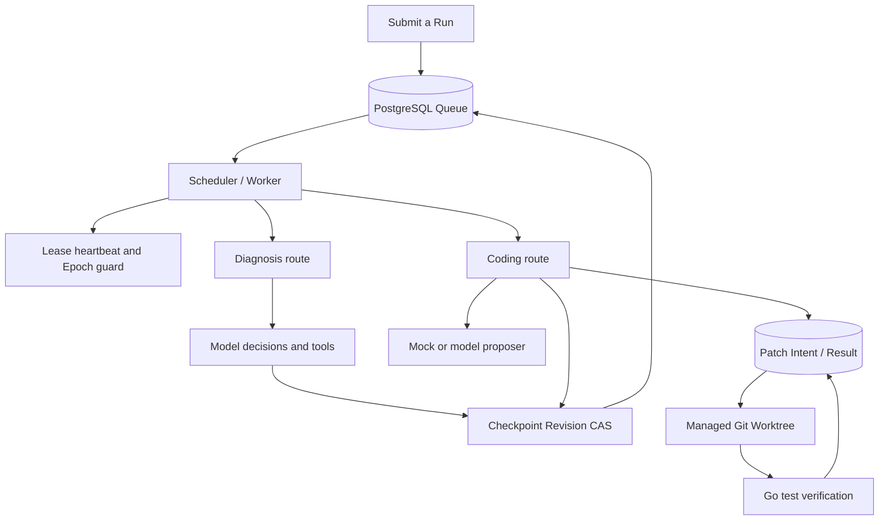
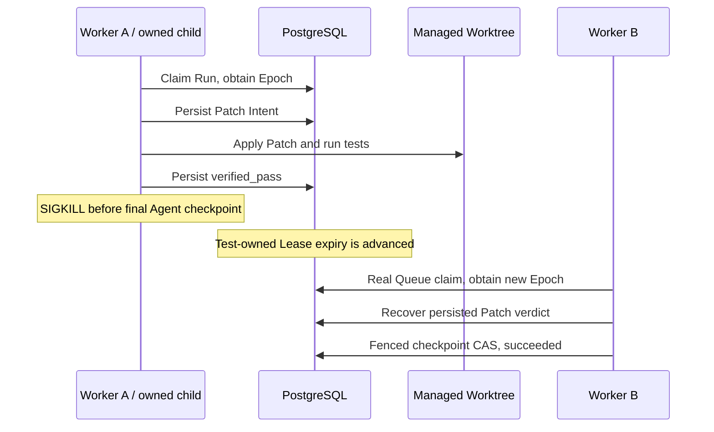

# Durable Coding Agent Runtime

A Go engineering project exploring durable agent execution, PostgreSQL-backed
scheduling, lease fencing and crash recovery for controlled code repair.

**This public repository contains design documentation and validation summaries.**
The implementation, tests, database migrations and executable demos are maintained
privately. This repository can be read on GitHub; it does not provide a runnable
application or source-code download.

简要说明：这是项目的公开文档展示版，介绍架构、故障恢复协议、测试结果与能力边界。
实现源码和运行材料保留在私有仓库中；本仓库不需要配置数据库或模型密钥。

## Engineering problem

A Worker can change a file and then crash before recording completion.
A replacement Worker needs to determine what already happened, obtain a new
execution grant and finish without trusting the previous process's memory.

The implementation records Patch Intent before writing, reconciles file hashes
during recovery and persists results only under a valid Lease/Epoch.
Patch completion and Agent Run completion are separate durable boundaries.

## Implemented capabilities

The following capabilities describe the privately maintained implementation:

- PostgreSQL Queue with atomic priority/availability claims.
- Lease heartbeat, Worker Epoch Fencing and checkpoint Revision CAS.
- Diagnosis and Coding routes within the existing Scheduler.
- Managed Git Worktrees with baseline and identity validation.
- Durable Patch Intent/Result with recovery from four persisted Patch states.
- Separate claim, explicit retry and logical repair budgets.
- Deterministic Mock proposals for controlled single-file Go repairs.
- Real PostgreSQL, concurrent-owner and owned-child SIGKILL tests.

No throughput or latency benchmark is claimed.

## Architecture

## Reading guide

| Document | What it explains |
| --- | --- |
| [Architecture](docs/architecture.md) | Component boundaries, persistence and Worktree ownership |
| [Execution lifecycle](docs/execution-lifecycle.md) | Claim, heartbeat, checkpoint and retry behavior |
| [Crash recovery](docs/crash-recovery.md) | Takeover and reconciliation after a Worker dies |
| [Patch protocol](docs/patch-protocol.md) | Intent, file hashes, guarded apply and cached verdicts |
| [Design decisions](docs/design-decisions.md) | Trade-offs and explicit limits |
| [Testing](docs/testing.md) | Private implementation test scenarios and acceptance rules |
| [Validation summary](docs/validation.md) | Recorded results and what readers can verify here |

## Demonstration walkthrough

This textual walkthrough describes a controlled experiment that was run against
the private implementation. It replaces executable setup instructions in the
public edition.

1. Create a temporary Git repository containing a failing single-file Divide test.
2. Submit a Run and acquire it through the actual Queue claim operation.
3. Start the existing Scheduler execution path, its Lease heartbeat and a managed Worktree.
4. Obtain a deterministic Mock proposal and persist Patch Intent before applying it.
5. Run Go tests in the Worktree and persist the verification result.
6. Save the final fenced Agent checkpoint and check that the source repository
   is unchanged and the terminal Run cannot be claimed again.

The Mock path requires no live model API key. Its reported outcome is a passing
repair scenario; the source and raw execution output are not distributed here.

## Crash recovery walkthrough

The private test harness also kills owned child processes after prepared,
applied, verified_pass and verified_fail states. Takeover obtains its Epoch
through a real Queue claim. Tests advance only their own Run's expiry to keep
the experiment bounded; they do not simulate takeover by directly changing Epoch.

These are bounded integration scenarios, not a long-running production load test.

## Validation at a glance

The private implementation was validated on Linux/WSL with Go 1.27.1 and
PostgreSQL 16, without a live model API key:

| Recorded suite | Passed test entries | FAIL | SKIP |
| --- | ---: | ---: | ---: |
| Full project | 207 | 0 | 0 |
| Full project with race detector | 207 | 0 | 0 |
| Database-independent suites | 127 | 0 | 0 |

Counts include parent tests, subtests and child-helper entries.
The private implementation CI passed again after commit-identity cleanup.
These are recorded implementation results, not CI checks executed by this
documentation repository. They cannot be independently reproduced from this
repository alone. See [validation details](docs/validation.md).

## Scope and limitations

- Controlled single-file Go repair; arbitrary multi-file repository repair is future work.
- Trusted repositories only: their tests execute with Worker OS privileges.
  No untrusted-code sandbox is implemented.
- Filesystem Rename and SQL Commit remain separate operations.
- Recovery assumes the same valid local Worktree; multi-host reconstruction is future work.
- No arbitrary-external-side-effect exactly-once guarantee.
- Lease timing depends on the database wall clock and an adequate TTL.
- Worktree identity checks operate within a trusted-writer model.

## Roadmap

Multi-file Patch, sandbox isolation, broader repair evaluation, OpenTelemetry,
measured throughput benchmarks and multi-host Worktree recovery remain future work.

Source-code publication and software licensing are outside this public
documentation edition.
