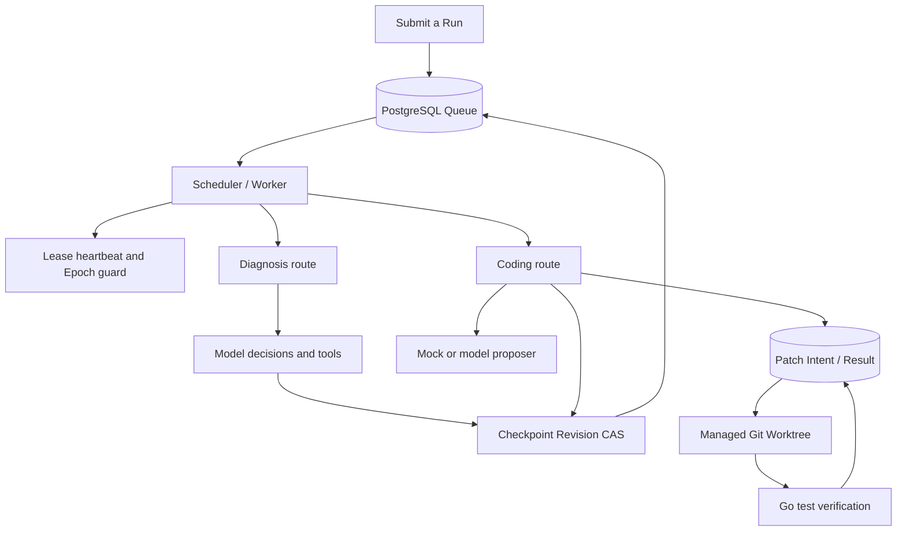
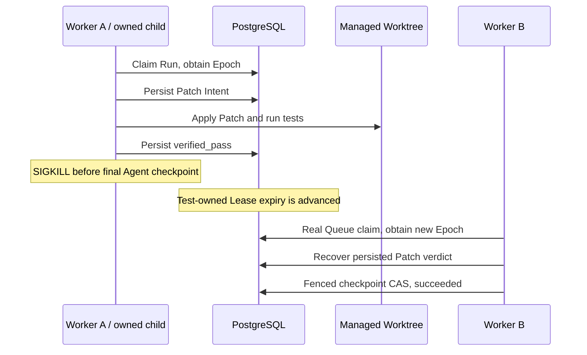

# Durable Coding Agent Runtime

[English](README.md) | [简体中文](README.zh-CN.md)

<!-- source-publication-version -->
> Companion source is published at [df93c3c](https://github.com/Loz888/durable-coding-agent-runtime-source/commit/df93c3c13b130b3d08a635a325cb592f4908fd52). [Evidence and limits](https://github.com/Loz888/durable-coding-agent-runtime-source/blob/df93c3c13b130b3d08a635a325cb592f4908fd52/reports/runtime-followup-20261022/README.md) · [GitHub CI](https://github.com/Loz888/durable-coding-agent-runtime-source/actions). “Uncommitted/not pushed” wording below records acceptance-time snapshots rather than current publication status.

<!-- publication-note-20261022 -->
> This publication includes the validated upgrades below. “Local/uncommitted/not pushed” statements are retained acceptance-time snapshots; use repository commits and Actions for publication and CI status. Two synthetic test DSNs were changed to explicit placeholders before publication, preserving decoding and error-redaction assertions; related offline checks were rerun.

<!-- runtime-followup:start -->
## 2026-10-22 follow-up: sealed sandbox inputs and measured evidence

The shared metadata-only input planner now generates fixed offline commands for standalone, sealed-vendor and bounded workspace snapshots. Worker verification policy v4 includes the input mode. Four real Docker scenarios passed (vendor/workspace success and actual assertion failure), preserving non-root, read-only, offline execution and no host fallback.

A read-only artifact inventory passed five controlled categories without changing files or references. Two reference observations never authorize deletion; coordinated artifact GC remains unimplemented. Twelve additional synthetic trials completed **12,003 tasks, zero failures and zero extra claims**, including 35-second callbacks against an initial 30-second lease, pool limits 4/20 and approximately 107-second paced trials. Six negative database wall durations remain recorded; these are not production capacity, long-term soak or model throughput results.

One frozen real upstream go-humanize regression failed on its parent and passed with the known upstream fix inside offline containers. **Model calls: 0.** Runtime ingestion, representative real-defect evaluation and independent human review remain unverified. A read-only probe accounting for scheduling uncertainty still observed three OS and three PostgreSQL backsteps over 90 seconds; the time service remains unchanged pending the separate A/B authorization.

This documents the companion source working tree. Evidence lives locally in source `reports/runtime-followup-20261022` and is not yet pushed; this showcase runs no software CI.
Full regression and race: **407 PASS / 0 FAIL / 0 SKIP each**. The database-independent entry passed 206 Go events and 7 Python tests; event counts include parents/subtests. Local changes only: no commit, push, or new paid call.
<!-- runtime-followup:end -->

> Local monitoring reproduced OS and PostgreSQL wall-clock backsteps. A system-wide WSL time-sync A/B is awaiting explicit approval; it has not been applied. Primary benchmark timing is monotonic.

> Previous batch full/race: 338 PASS each; ten recovery repeats: 220 PASS; unit entrypoint: 153 PASS. Zero FAIL/SKIP. Real Docker/fenced container recovery passed. See source reports/runtime-remaining-20261022. Events include parent/subtests; no commit/push.

## Local upgrade · 2026-10-22 (unpublished)

This section describes the current working tree; older dated “pending/BLOCKED” statements are historical. No commit, push or remote-CI result is implied.

Implemented bounded multi-file patches (up to 8 allowlisted existing Go files per repair round), persisted logical model responses with conservative unknown-outcome handling, real Docker confinement and an independent scoped orphan reaper, OTLP/metrics/local alert acceptance, paced/real-Go-test benchmark workloads, and content-addressed portable Worktree recovery. Two isolated host containers plus a separate authenticated artifact service passed actual A-container SIGKILL, natural lease expiration and a real Epoch2 ClaimBatch takeover. This remains one physical computer, with no physical-host/power-loss claim.

The frozen 12-task synthetic live evaluation made **11 actual requests**, **3382 input / 4201 output tokens**: 9 fresh repairs and one response-recovery control passed holdout assertions; an immutable failure control failed as expected; an already-passing baseline made zero requests. Mode: High, requested/returned alias `deepseek-flash`. The peak cache-miss estimate is **$0.0060558**, not an invoice, against this run's separately authorized $2 cap. These simple manually constructed tasks do not measure general repository repair accuracy.

Explicit sealed input policies capture offline vendor inputs or root-contained workspace modules, with shared fixed-command planning for trusted-local and sandbox execution. Terminal Worktrees can be inspected/dry-run and retired with identity/state checks and a persisted deletion intent. A separate fresh local PostgreSQL cluster restored synthetic data and read-only role permissions.

Portable recovery requires a previously published artifact and durable patch history. Disk loss before the first publication and unobserved model responses are not automatically recovered.

Remaining unverified: a second physical host, network partition/power loss, arbitrary hostile repositories, representative real-world defects and human review, production soak/capacity, and the cause of two historical negative DB wall-clock durations. Monotonic benchmark timing does not remove the Lease clock assumption.

A Go engineering project exploring durable agent execution, PostgreSQL-backed
scheduling, lease fencing and crash recovery for controlled code repair.

**This repository contains design documentation and validation summaries.**
Implementation source, tests, database migrations and executable demos are
available in the [source repository](https://github.com/Loz888/durable-coding-agent-runtime-source).
This repository remains a documentation-focused edition.

简要说明：这是项目的双语文档展示版；可运行源码与中英文使用说明见上方源码仓库链接。

## Historical local extension batch 1 · 2026-10-21 (unpublished)

The companion source now includes optional OpenTelemetry SDK/local NDJSON tracing, a real-PostgreSQL synthetic throughput benchmark and a frozen 20-case scripted repair evaluation with an independent oracle. Latest full/race runs pass 309 events each; ten targeted race runs pass 90, and the database-independent entrypoint passes 147. All have zero FAIL/SKIP; events include parent/subtests and helper entries. This documentation repository still has no software CI.

The benchmark completes 2400 tasks over 12 trials with no failures/extra claims, using fixed 20ms callbacks, not model work or production capacity. All 20 expected behaviors match, including failure controls: 17 visible positives, 16 oracle positives, and one intentional overfit rejected by the oracle. There are no new live-model calls. Real containers remain BLOCKED; multi-file and multi-host recovery are incomplete. Local evidence is under the companion source's `reports/runtime-extension-20261021/verification.json`; these files are unpublished, so no premature remote file links are provided. Apply migrations 001–012 before tracing. Earlier 301/260 snapshots below remain historical.

## Historical local engineering completion · 2026-10-21 (unpublished)

The companion source working tree adds complete bounded candidate snapshots and versioned verification-input digests for standalone stdlib-only Go modules. Successful persisted patches on the last execution claim can be finalized through a Run-row transaction without another Claim/Epoch, repair round or model call. Stale evidence is rejected; old owners remain fenced. The final full and race checks each passed **301 test/subtest events, zero failures/skips** locally after the Worker startup adjustment. The core five-package ten-repeat check passed **1,360 events, zero failures/skips**. See [local validation scope](docs/validation.md#local-engineering-acceptance--2026-10-21-unpublished). This documentation repository does not run software CI.

Stop old Workers, apply source migrations **001–011**, then start the new Worker. Container adapter code exists, but actual isolation remains unverified. Source `docs/demo-script.md` and `reports/review-20261020/engineering-20261021.json` are local, not yet published; the GitHub main link below still describes its published baseline. Historical live/Mock model scores are unchanged; no paid calls were made.

## Historical local snapshot · 2026-10-20

Aligned to source baseline fdbfacb plus local demo-log changes. Full/race local verification each pass 260 test/subtest events. Terminal times freeze transactionally; execution status is distinct from diagnostic evidence consistency. The historical live single-file repair (274 input / 94 output tokens, exact model configuration unknown) remains separate from Day21 Mock 12/12. Actual container isolation is unverified. [Current published source evidence](https://github.com/Loz888/durable-coding-agent-runtime-source/blob/main/docs/review-20261020/RESULTS.md).

The companion local source now has docs/demo-script.md: real Claim Epoch 1 → owned child SIGKILL after verified_pass and before final Checkpoint → real Epoch 2 takeover → cached result/final checkpoint. This is a test-driven Worker path, not daemon failover or an exactly-once guarantee. This showcase update is local and unpublished.

## Engineering problem

A Worker can change a file and then crash before recording completion.
A replacement Worker needs to determine what already happened, obtain a new
execution grant and finish without trusting the previous process's memory.

The implementation records Patch Intent before writing, reconciles file hashes
during recovery and persists results only under a valid Lease/Epoch.
Patch completion and Agent Run completion are separate durable boundaries.

## Implemented capabilities

The following capabilities describe the published implementation:

- PostgreSQL Queue with atomic priority/availability claims.
- Lease heartbeat, Worker Epoch Fencing and checkpoint Revision CAS.
- Diagnosis and Coding routes within the existing Scheduler.
- Managed Git Worktrees with baseline and identity validation.
- Durable Patch Intent/Result with recovery from four persisted Patch states.
- Separate claim, explicit retry and logical repair budgets.
- Deterministic Mock proposals for controlled single-file Go repairs.
- Real PostgreSQL, concurrent-owner and owned-child SIGKILL tests.

Day 21 adds a small recorded Mock evaluation; no general throughput or latency benchmark is claimed.

## Architecture

## Reading guide

| Document | What it explains |
| --- | --- |
| [Architecture](docs/architecture.md) | Component boundaries, persistence and Worktree ownership |
| [Execution lifecycle](docs/execution-lifecycle.md) | Claim, heartbeat, checkpoint and retry behavior |
| [Crash recovery](docs/crash-recovery.md) | Takeover and reconciliation after a Worker dies |
| [Patch protocol](docs/patch-protocol.md) | Intent, file hashes, guarded apply and cached verdicts |
| [Day 21 evaluation](docs/evaluation.md) | Four scenarios, recorded observations, scoring and timing limits |
| [Design decisions](docs/design-decisions.md) | Trade-offs and explicit limits |
| [Testing](docs/testing.md) | Implementation test scenarios and acceptance rules |
| [Validation summary](docs/validation.md) | Recorded results and what readers can verify here |

## Demonstration walkthrough

This textual walkthrough describes a controlled experiment that was run against
the implementation. It replaces executable setup instructions in the
public edition.

1. Create a temporary Git repository containing a failing single-file Divide test.
2. Submit a Run and acquire it through the actual Queue claim operation.
3. Start the existing Scheduler execution path, its Lease heartbeat and a managed Worktree.
4. Obtain a deterministic Mock proposal and persist Patch Intent before applying it.
5. Run Go tests in the Worktree and persist the verification result.
6. Save the final fenced Agent checkpoint and check that the source repository
   is unchanged and the terminal Run cannot be claimed again.

The Mock path requires no live model API key. Its reported outcome is a passing
repair scenario. Runnable source and selected Day 21 observations are available
in the source repository; raw execution logs are not distributed here.

## Crash recovery walkthrough

The implementation test harness also kills owned child processes after prepared,
applied, verified_pass and verified_fail states. Takeover obtains its Epoch
through a real Queue claim. Tests advance only their own Run's expiry to keep
the experiment bounded; they do not simulate takeover by directly changing Epoch.

These are bounded integration scenarios, not a long-running production load test.

## Day 21 evaluation

A recorded deterministic Mock dataset covers four controlled scenarios with
three trials each: repair, already-passing baseline, two-round budget exhaustion
and verified-result takeover. Scenario checks passed 12/12; fresh repair passed
3/3 and verified-result recovery passed 3/3. Unsupported success claims were 0/9.

Recorded P50/P95 were 400/1403 ms over 12 samples. Token usage was unknown in all
12 trials; zero token accumulators are not measured zero cost. These are small
fixture-specific observations, not live-model success or production performance.

The Day 21 takeover seeds a verified result and performs a real new claim.
It does not kill a Worker; the separate Day 20 test performs real SIGKILL before
the final Agent checkpoint.

See [methodology and source data](docs/evaluation.md), including public cases,
JSONL, summary, scorer and reproduction instructions.

## Historical validation snapshot · 2026-10-17

Historical published snapshot at showcase 19a60e4; current local evidence is above.

The 2026-10-17 implementation snapshot was validated on Linux/WSL with Go 1.27.1
and PostgreSQL 16, without a live model API key. Current local results appear above:

| Recorded suite | Passed test entries | FAIL | SKIP |
| --- | ---: | ---: | ---: |
| Full project | 226 | 0 | 0 |
| Full project with race detector | 226 | 0 | 0 |
| Database-independent suites | 133 | 0 | 0 |

Counts include parent tests, subtests and child-helper entries.
Current software CI is available in the [source repository Actions](https://github.com/Loz888/durable-coding-agent-runtime-source/actions).
These are recorded implementation results, not CI checks executed by this
documentation repository. They cannot be independently reproduced from this
repository alone. See [validation details](docs/validation.md).

## Limitations

- Up to 8 allowlisted existing non-test Go files; no arbitrary large-repository repair or file creation/deletion.
- Real Docker boundaries were exercised; trusted-local/sealed-input policies remain trusted host execution.
- Portable recovery needs a matching clean clone, database and private artifacts; independent containers were tested, a second physical host/power loss was not.
- SQL, file Rename and artifact upload are separate durability boundaries. Unknown model outcomes/charges and external side effects have no Exactly-once claim.
- Synthetic live cases are not representative repository repair accuracy; Lease decisions still rely on the DB wall clock.

## Roadmap

See the current 2026-10-22 scope above. Next evidence requires a second physical host, representative open-source defects with human review, longer load tests and clock diagnostics.
