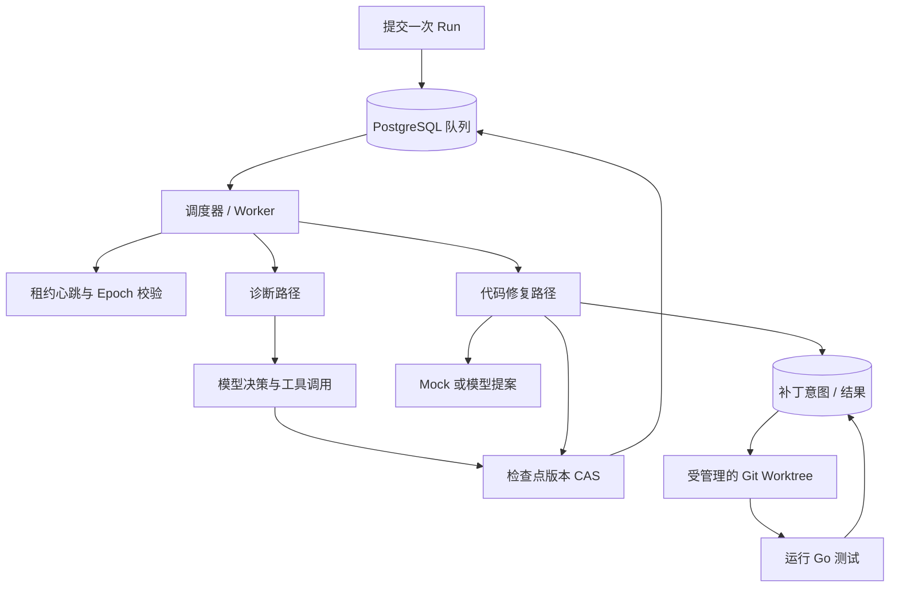
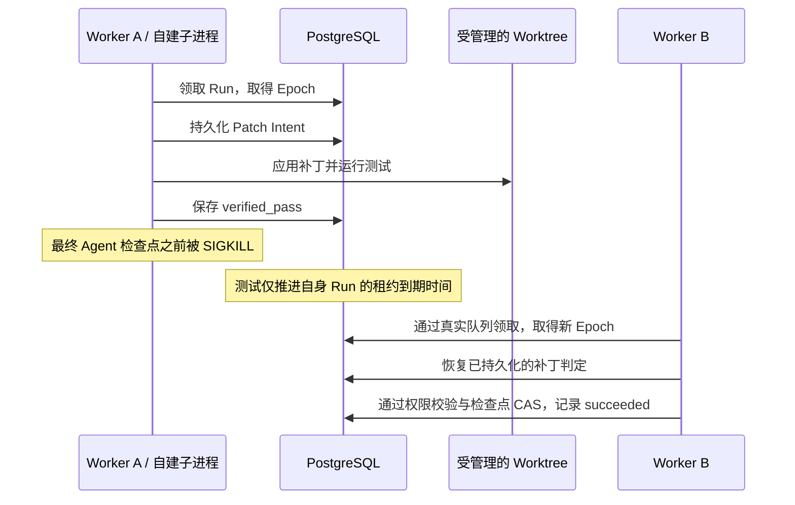

# Durable Coding Agent Runtime · 项目介绍

[English](README.md) | [简体中文](README.zh-CN.md)

<!-- source-publication-version -->
> 配套源码已同步至 [df93c3c](https://github.com/Loz888/durable-coding-agent-runtime-source/commit/df93c3c13b130b3d08a635a325cb592f4908fd52)；[实际验收与边界](https://github.com/Loz888/durable-coding-agent-runtime-source/blob/df93c3c13b130b3d08a635a325cb592f4908fd52/reports/runtime-followup-20261022/README.md) · [GitHub CI](https://github.com/Loz888/durable-coding-agent-runtime-source/actions)。下方“未提交／未推送”仅保留验收时快照，不表示当前发布状态。

<!-- publication-note-20261022 -->
> 本次同步包含下方已验收升级。文中“本地未提交／未推送”保留为验收时快照；当前发布版本与CI状态以本仓库提交记录和Actions为准。推送前仅将两处合成测试连接串改为明确占位凭据，保留解码与错误脱敏断言；相关离线检查重新执行。

<!-- runtime-followup:start -->
## 2026-10-22 续批：受限依赖沙箱、盘点与实测

- **已实现并运行**：`internal/goinput` 只解析元数据，在最终复制树上为默认标准库、sealed-vendor、sealed-workspace 生成固定离线测试命令；Worker 沙箱策略升级 v4，纳入输入策略。vendor / workspace 的成功与真实断言失败共 4 个 Docker 场景已通过，保留只读、禁网、非 root 与无宿主兜底。
- **已实现并运行**：`artifact-inventory` 只读盘点私有制品根与显式 schema 引用；5 类专用测试数据验收通过，文件与引用不变。两次观察不能证明完整引用或允许删除，真正 GC 仍未实现。
- **已实际测量**：新增 12 轮 / 12003 任务，失败与额外领取均为 0；包含 35 秒回调超过初始 30 秒 Lease、池 4 / 20 对照、每轮约 107 秒的持续流。主计时为单调时钟，6 个 DB 墙钟负时长保留；不是生产容量、长期 soak 或模型吞吐。
- **真实缺陷种子**：固定 go-humanize issue 130 的上游版本和回归断言，禁网容器中旧版带回归失败、已知修复版通过。模型调用 0；这不是模型修复成绩，Runtime 接入、代表性样本与独立人工复核仍待验证。
- **时钟仍待修复**：加入调度暂停不确定度后，90 秒探针仍观察到系统 / PG 各 3 次回退。服务未改动，候选原因的 A/B 对照仍待此前单独授权。

本页仅描述配套源码本地状态。完整证据位于源码 `reports/runtime-followup-20261022`，尚未推送；本展示仓库不运行软件 CI。
本轮完整回归和 race 各 **407 PASS / 0 FAIL / 0 SKIP**；数据库无关入口 Go 206 项、Python 7 项通过，计数含父 / 子测试。所有成果仍为本地修改，未提交或推送；没有新增付费调用。
<!-- runtime-followup:end -->

> 本轮已实测系统/数据库时钟同步倒退，候选原因和待授权对照已记录；未擅自改时间服务。

> 前批本地完整/race各338 PASS、关键恢复十轮220 PASS，均0 FAIL/0 SKIP；数据库无关153 PASS。真实Docker4场景与双容器接管通过。Live为12合成任务/11请求、3382/4201 Token、估价$0.0060558，非账单；Live绑定其实际较早二进制。物理双主机、断电、真实开源缺陷泛化、长期容量和历史时钟根因仍未验证。没有提交或推送。

## 2026-10-22 本地升级：实现与验收范围

本节是当前本地工作树；此前各日期的表格、BLOCKED 和“尚未实现”是历史快照。未提交或推送，本页不继承旧远端 CI。

| 方向 | 本轮交付 | 证据与边界 |
|---|---|---|
| 多文件补丁 | 同一逻辑轮次最多 8 个白名单 Go 文件，逐文件 before/after 摘要、全清单预检、统一验证 | 真实 Claim + 5 个 SIGKILL 窗口，含第一个 Rename 后的混合状态；多个 Rename 与 SQL 仍非原子操作 |
| 真实沙箱 | 固定镜像摘要、非 root、只读根、无网络、资源上限、超时；独立按身份清理孤儿 | 已运行真实 Docker；不是恶意内核逃逸证明，docker 组具有管理员级权限 |
| 模型恢复 | 请求意图、已观察响应与 Usage 持久化，恢复先复用响应；未知结果拒绝自动重发 | 3 个实际 SIGKILL 窗口；显式再授权最多 3 个逻辑尝试，物理费用预算另行约束，不保证 provider Exactly-once |
| 真实评测 | 冻结 12 项人工合成任务，High、deepseek-flash、单轮 | 11 次真实调用，3382 输入 / 4201 输出 Token；9 个新修复、1 个恢复对照通过独立断言，1 个不可修复对照按预期失败、1 个基线通过且零调用 |
| OTel | OTLP HTTP → Collector → Jaeger / Prometheus，耗时与错误指标、有界导出重试 | 实际读取 1 条新 Trace / 3 个 Span、指标和 firing 告警；受控错误，无外部联系人，SIGKILL 仍可能丢失缓冲数据 |
| 基准 | 真实 PG 固定等待、持续到达，以及真实 Worktree + Go test 负载 | 使用单调计时，保留数据库墙钟原值与异常计数；具体轮次见机器结果，不代表 LLM 吞吐或生产容量 |
| 可迁移 Worktree | 基线 commit + 有界全文件制品 + 持久化补丁链；新 Claim 下重建身份并重验 | 两个独立容器目录和第三个制品服务已验证；A SIGKILL、自然到期、B 真实 Epoch2 接管；只有一台物理电脑 |
| 输入与生命周期 | 显式 sealed-vendor / sealed-workspace 离线输入策略；终态 Worktree dry-run/受保护退役；数据库与角色恢复实验 | sealed 输入已完成 4 个真实沙箱场景；Workspace 限根内模块，不支持任意依赖图；数据库恢复只使用新建合成库 |

真实调用收到的型号字段为 `deepseek-flash`，这是服务端别名，不是不可变模型权重快照。2026-10-22 官方文档将它路由至 DeepSeek-V4.1-Flash-1017。峰时 cache-miss 上界估价 **$0.0060558**，不是供应商账单；本轮授权上限 $2，历史预算没有挪用。原始响应不公开推理内容或 Key。

可迁移恢复只覆盖已有已提交制品和持久化补丁链；首次制品提交前丢盘、未观察模型输出及任意外部副作用不能自动恢复。

仍未验证：第二台物理主机、网络分区/断电、任意不可信大型仓库、真实开源缺陷总体修复率、独立人工判定、长时生产压力/SLA，以及历史两条数据库负时长的根因。单调计时没有消除 Lease 对数据库墙钟的依赖。没有自动提交、推送或对外发布。

一个使用 Go 构建的 Agent 工程项目，关注执行状态持久化、PostgreSQL 调度、
租约校验，以及受控代码修复中的崩溃恢复。

**本仓库提供设计文档与验证结果摘要。**
实现源码、测试、数据库迁移和可执行 Demo 已在[源码仓库](https://github.com/Loz888/durable-coding-agent-runtime-source)公开。
本仓库仍专注于文档阅读；运行说明见[源码仓库中文 README](https://github.com/Loz888/durable-coding-agent-runtime-source/blob/main/README.zh-CN.md)。

## 历史本地扩展批次1 · 2026-10-21（尚未推送）

配套源码已新增可选OpenTelemetry SDK/本地NDJSON追踪、真实PostgreSQL合成吞吐量基准，以及冻结20场景Scripted提案/独立Oracle评测。最新全量/race各309 PASS、0 FAIL/SKIP；新增链路十轮race为90 PASS、纯本地入口147 PASS。计数含父/子测试与辅助入口，非场景种数。本展示仓库仍没有软件CI。

基准12轮共2400任务全部完成，失败/额外领取0；合成callback固定20ms，不代表模型吞吐或生产容量。20/20预期行为符合包含失败对照；17个可见测试通过，16个Oracle通过，1个预设过拟合被Oracle拒绝。新真实模型调用0。真实容器仍BLOCKED，多文件和跨主机尚未实现。证据在配套源码本地`reports/runtime-extension-20261021/verification.json`，未发布，故不提供尚不存在的远端链接。

启用追踪前应用源码001–012迁移。保留下面各有日期的301/260等历史快照；它们不覆盖本批新增代码。

## 历史本地工程收口 · 2026-10-21（尚未推送）

配套源码新增受控候选全树快照与验证输入摘要；当前仅标准库独立Go模块。最后一次领取后，若已保存补丁成功证据且完整输入仍匹配，可在同Run事务内收尾，不新增Claim/Epoch、修复轮数或模型请求；旧Owner仍被拒绝。最新 Worker 启动修正后的最终全回归/race 各 **301 个测试/子测试事件通过，0 FAIL/SKIP**。核心五包十轮回归 **1,360 PASS、0 FAIL、0 SKIP**。详见[本地验收范围](docs/zh-CN/validation.md#本地工程验收--2026-10-21未发布)。本展示仓库没有软件CI，不继承源码的CI状态。

先停止旧 Worker，应用源码迁移 001–011，再启动新 Worker。容器适配器已有代码，实际隔离尚未验收。源码的docs/demo-script.md与engineering-20261021.json仍仅在本地，下面GitHub链接仍对应已发布基线。历史模型结果保留，本轮付费调用0。

## 历史本地快照 · 2026-10-20

本页对齐源码基线 fdbfacb 及本地演示日志改动；全回归/race 各 260 个测试/子测试事件通过。终态时间冻结，执行完成与诊断证据一致性分开。历史真实单文件修复（输入 274 / 输出 94 Token，完整模型配置未知）与 Day21 Mock 12/12 分别记录；真实容器隔离仍未验收。[当前已发布源码证据](https://github.com/Loz888/durable-coding-agent-runtime-source/blob/main/docs/review-20261020/RESULTS.md)。

配套源码本地新增 docs/demo-script.md：真实 Epoch 1 领取 → verified_pass 后/最终 Checkpoint 前自建子进程 SIGKILL → 真实 Epoch 2 接管 → 复用结果并完成 Checkpoint。它是测试驱动 Worker 路径，不是常驻服务故障切换或 Exactly-once。本次展示修改仅保存在本地，尚未推送。

## 项目解决什么问题

Worker 修改文件后，可能在记录完成状态之前崩溃。
接手的 Worker 需要确认之前已经发生了什么，重新取得执行权限，
并在不依赖上一个进程内存的情况下完成后续工作。

实现采用以下方式处理这个窗口：写文件前持久化 Patch Intent（补丁意图），
恢复时核对文件哈希，持有有效 Lease（租约）和 Epoch（执行代次）时才允许保存结果。
补丁完成与 Agent Run 完成是两个独立的持久化边界。

## 已实现的能力

下面介绍的是实现中已具备的能力：

- PostgreSQL 队列，支持按优先级和可用时间原子领取任务。
- 租约心跳、Worker Epoch 隔离校验，以及检查点 Revision CAS（版本比较并交换）。
- 在同一个现有 Scheduler 中调度诊断与代码修复两条路径。
- 使用 Git Worktree 隔离修改，并校验基线提交与工作区身份。
- 持久化 Patch Intent/Result，覆盖四种补丁状态的崩溃恢复。
- 分别限制领取次数、显式重试次数和逻辑修复轮次。
- 使用确定性的 Mock 提案，完成受控的单文件 Go 修复。
- 真实 PostgreSQL、并发持有者和自建子进程 SIGKILL 测试。

项目未声明未经测量的吞吐量或延迟指标。

## 系统架构

## 阅读导航

| 文档 | 主要内容 |
| --- | --- |
| [系统架构](docs/zh-CN/architecture.md) | 组件职责、持久化边界与 Worktree 归属 |
| [执行生命周期](docs/zh-CN/execution-lifecycle.md) | 领取、心跳、检查点与重试流程 |
| [崩溃恢复](docs/zh-CN/crash-recovery.md) | Worker 退出后的接管与状态核对 |
| [补丁协议](docs/zh-CN/patch-protocol.md) | 补丁意图、文件哈希、受保护写入与缓存判定 |
| [Day21 评测](docs/zh-CN/evaluation.md) | 四类场景、原始观测、评分口径与计时限制 |
| [设计取舍](docs/zh-CN/design-decisions.md) | 技术选择、代价与适用边界 |
| [测试策略](docs/zh-CN/testing.md) | 实现中的测试场景与验收规则 |
| [验证结果](docs/zh-CN/validation.md) | 已记录的结果及公开文档的验证范围 |

## 修复演示流程

以下文字描述了已在实现上执行的受控实验。
公开展示版使用文字流程介绍实验，不提供可执行的环境搭建步骤。

1. 创建临时 Git 仓库，放入单文件 Divide 函数的失败测试。
2. 提交一次 Run，通过真实队列领取操作取得任务。
3. 进入现有 Scheduler 执行路径，启动租约心跳并准备受管理的 Worktree。
4. 获取确定性的 Mock 提案，在应用补丁之前先持久化 Patch Intent。
5. 在 Worktree 中运行 Go 测试，保存验证结果。
6. 保存经过执行权限校验的 Agent 检查点，并验证原始仓库未被修改、
   已完成的 Run 不会再次被领取。

Mock 路径不需要真实模型 API Key。该实验记录的结果是修复场景通过；
可运行源码已单独公开；本文档仓库不分发原始执行输出。

## 崩溃恢复演示流程

实现测试还分别在 prepared、applied、verified_pass 和 verified_fail 状态后，
终止测试自己创建的子进程。接管时的 Epoch 来自真实队列领取。
为了缩短等待，测试只推进自身 Run 的到期时间，不直接修改 Epoch 来模拟接管。

这些是有明确范围的集成测试场景，不能代替长期生产负载测试。

## Day21 评测

已记录的确定性 Mock 数据包含四类受控场景，每类三次：
修复失败基线、基线已通过、两轮预算耗尽、接管已验证结果。
场景检查 12/12 通过，其中新修复 3/3、已验证结果恢复 3/3；
缺少证据的成功声明为 0/9。

12 个样本的历史 P50/P95 为 400/1403 ms。所有试验的 Token 用量均未知；
累计字段为零不代表测得零费用。这些结果只描述小规模受控夹具，
不能推广为真实模型成功率或生产性能。

Day21 接管场景预先保存已验证结果，再通过真实领取取得新执行权限，
并没有终止 Worker。真实 SIGKILL 由独立的 Day20 最终检查点前崩溃实验覆盖。

[评测方法与源码数据](docs/zh-CN/evaluation.md)提供公开的场景、
JSONL、汇总、评分器及复现说明。

## 历史验收快照 · 2026-10-17

以下为展示仓库19a60e4已发布历史快照；当前本地验收见上方。

以下属于 2026-10-17 的实现快照，验证环境为 Linux/WSL、Go 1.27.1 和 PostgreSQL 16，
未使用真实模型 API Key；当前本地结果见页首：

| 已记录的测试集 | 通过的测试条目 | FAIL | SKIP |
| --- | ---: | ---: | ---: |
| 全项目测试 | 226 | 0 | 0 |
| 全项目竞态检测 | 226 | 0 | 0 |
| 不依赖数据库的测试集 | 133 | 0 | 0 |

条目数包含父测试、子测试和子进程辅助测试入口。
当前软件 CI 状态见[源码仓库 Actions](https://github.com/Loz888/durable-coding-agent-runtime-source/actions)。
以上是实现工程的历史验证记录，并非这个文档仓库执行的 CI 结果；
仅凭本仓库无法独立复现这些软件测试。详见[验证结果说明](docs/zh-CN/validation.md)。

## 能力范围与限制

- 当前最多8个白名单既有Go文件；不新增/删除文件，不修改测试，不是任意大型仓库开发代理。
- 实际Docker边界已验收；trusted-local与sealed依赖策略仍是可信宿主执行，不接收任意恶意代码。
- 制品恢复依赖同commit干净clone、数据库和私有制品存储；已测独立容器，第二台物理主机/断电未验证。
- SQL Commit、文件Rename、制品上传仍是独立持久化边界；只对已知意图进行受保护协调。
- 未观察模型结果、未知费用、任意外部副作用均无Exactly-once保证；Lease依赖数据库墙钟。
- Live样本均为冻结人工合成案例；无真实用户反馈或代表性开放缺陷修复率。

## 后续计划

当前已实现与未验证边界见文首2026-10-22状态表。下一阶段优先真实第二主机、代表性开源缺陷及人工审查、长时压力和时钟异常诊断；不扩大本轮合成实验结论。
